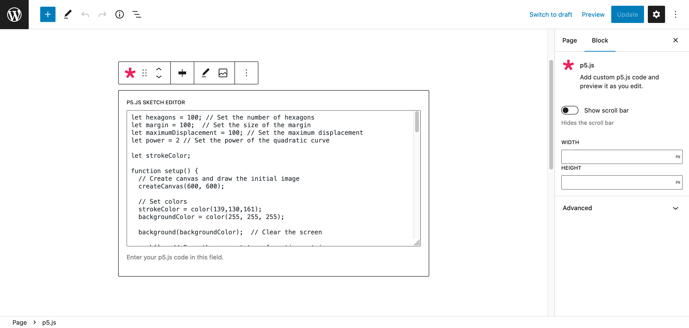

# Gutenbergp5 - Easy p5.js Block



Adds a Gutenberg block to add custom p5.js code in your pages and preview it as you edit.

Find this plugin in the [Wordpress Plugin Directory](https://wordpress.org/plugins/easy-p5-js-block/).

[Try it out on a free dummy site now !](https://tastewp.org/plugins/easy-p5-js-block/)

## Description

This p5.js Gutenberg block plugin is the perfect tool for showcasing your generative art or adding an extra level of visual interest to your website. With [p5.js](https://p5js.org/), you can create interactive, dynamic, and customizable visuals that will keep your audience engaged and excited. Whether you're an artist, designer, or developer, this plugin makes it easy to integrate your p5.js sketches into your WordPress website. Impress your visitors with your stunning generative art and take your website to the next level with our p5.js Gutenberg block plugin.


## Acknowledgements
This plugin is similar to [Mark Uraine's p5js block](https://wordpress.org/plugins/wp-p5js-block/), and is in fact reverse engineered from it, although very little of the actual code is reused (see [mapk/p5js-block](https://github.com/mapk/p5js-block), and his [blog post about his plugin](https://markuraine.com/creating-the-p5-js-gutenberg-block/)). I was prompted to develop this plugin due to encountering bugs, lack of display options, and mostly the lack of updates and support for this original plugin. I feel like it should be easier to insert p5.js artworks into Wordpress websites and blogs, and this is my contribution to it (although it may be buggy, I try my best. Feel free to open an issue or a pull request).

This project uses the p5.js library version 1.11.0, which is free software under the [LGPL License](https://p5js.org/copyright/). Currently, this plugin does not include the `p5.sound.js` libraries.

## Installation

1. Upload the plugin files to the `/wp-content/plugins/gutenbergp5` directory, or install the plugin through the WordPress plugins screen directly.

2. Activate the plugin through the 'Plugins' screen in WordPress

## Usage

1. In the WordPress editor, create or edit a page where you want to add the p5.js block.
2. Add a new block and search for "p5.js block" or locate it under the "Media" category.
3. Configure the block settings, including your custom p5.js code.
4. Preview and publish the page to see your p5.js artwork in action.


## Contribute

If you would like to contribute to the development of Gutenbergp5, you are welcome to do so.
The development environment uses [wp-env](https://developer.wordpress.org/block-editor/reference-guides/packages/packages-env/), which requires Docker and Node.js.
Follow the instructions below to set up the development environment:

1. Clone the repository:

```bash
git clone https://github.com/florian-rieder/gutenbergp5.git
```
2. Navigate to the plugin directory and install the dependencies:
```bash
cd gutenbergp5
npm install
```
3. Start WordPress with the plugin mounted and activated:
```bash
npm run env:start
```
4. In another terminal, build the block and rebuild on changes:
```bash
npm start
```
5. Open your browser and go to [http://localhost:8888](http://localhost:8888) (log in at `/wp-admin` with `admin` / `password`).

Stop the environment with `npm run env:stop`, or remove it entirely with `npm run env:destroy`. To change ports or the WordPress version locally, create a `.wp-env.override.json`.

### Tests

End-to-end tests in `tests/e2e` check the block in the editor, its preview, and the published post, on Chromium, Firefox and WebKit. They use [Playwright](https://playwright.dev) and run against the separate test site that `npm run env:start` also starts at [http://localhost:8889](http://localhost:8889). They run on GitHub Actions for every push to `master` and every pull request.

```bash
npx playwright install            # once, downloads the browsers
npm run build                     # the tests use the built block
npm run test:e2e                  # all browsers
npm run test:e2e -- --project=firefox
npm run test:e2e:ui               # interactive runner, to debug a test
```

After a failure, `npx playwright show-report` opens the report with screenshots, videos and traces.

Feel free to explore the code, open issues, or submit pull requests to contribute to the improvement of the plugin. Your contributions are greatly appreciated!

## Releasing

1. Run `/release-notes` in Claude Code. It proposes the next version and writes the changelog entry in `readme.txt` and `readme.md`. Review it.
2. Commit the changelog, bump the version (this commits and tags), then push. `npm version` refuses to run while tracked files have uncommitted changes, so the changelog has to be committed first:
```bash
git commit -m "docs: changelog for <version>" readme.txt readme.md
npm version <version>
git push --follow-tags
```
3. On GitHub, open the draft release that the tag created. Check the notes and the attached zip.
4. Click **Publish release**. This deploys the zip to WordPress.org. Pre-releases stay on GitHub only.

## Screenshots


## Changelog

### 1.1.3
* Tested with WordPress 7.1.

### 1.1.2
* Moved p5.js dependency to a local asset instead of using a CDN link.
* Updated p5.js to 1.11.0.
* Fixed horizontal overflow with full width option.
* Fixed preview overflow issues.
* Improved canvas auto-sizing.

### 1.1.1
* Speculative fix for a bug where the canvas sizing would fail on chromium-based browsers.

### 1.1.0

* Added a "Full width" alignment option.
* Fixed a bug where the iframe sizer would sometimes fail, because the iframe had not yet loaded.

### 1.0.0

* Released working block with sizing, layout and scrollbar settings.

## License

Gutenbergp5 is licensed under the [GPL-2.0-or-later](https://www.gnu.org/licenses/gpl-2.0.html) license.
